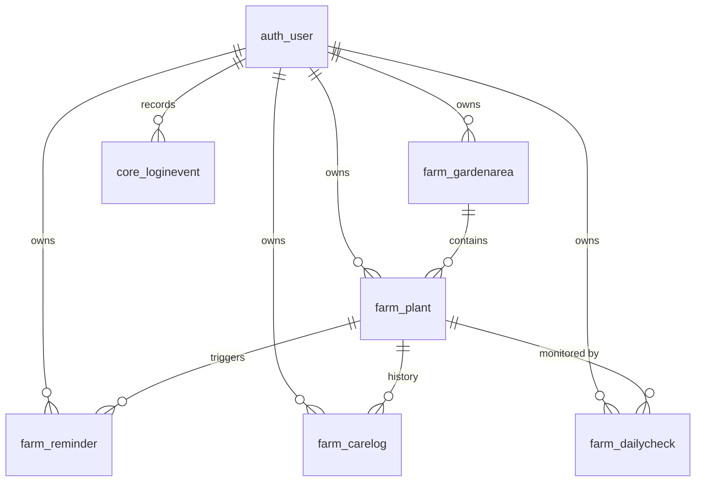

# MOSQUERA Farm Logs

A Django farm-management web app for tracking plantings, harvests, watering,
fertilizing, daily plant health, care history, and garden layouts. It includes
weather-adaptive reminders, companion-planting alerts, AI care advice, and
role-based accounts with login tracking.

## Members

- Mosquera, Carl John
- Lirazan, Adrian
- Lucasan, Arc Xerlan

## Features

### Farm management

- **Planting & harvest tracking** — record crop name, variety, planting
  date, quantity, status, harvest ETA, and notes.
- **Crop-aware harvest estimates** — a built-in maturity catalog covers common
  vegetables and Philippine perennial fruit crops (rambutan, mango, calamansi,
  papaya, banana, jackfruit, avocado, lanzones, and durian), accepts
  singular/plural/local names, and adjusts the estimate for direct-seeded
  versus transplanted or grafted crops.
- **Tailored care defaults** — water and fertilize intervals fill in live from
  the selected crop's catalog profile, with per-plant overrides.
- **Custom reminders** — water, fertilize, harvest, and custom alerts with due
  dates, overdue badges, completion history, and automatic rollover for
  recurring care.
- **Garden areas & visual map** — define yards, raised beds, indoor pots, and
  greenhouses as grids; place plants by cell, drag them between cells, and
  auto-arrange unplaced plants.
- **Companion-planting alerts** — the map flags beneficial and harmful
  neighboring pairings (e.g. tomato + potato, basil + tomato).
- **Care history** — growth, pest, weather, and general notes with optional
  progress photos.
- **Daily monitoring** — one entry per plant per day with watered/fertilized
  toggles, health status (Poor, Fair, Good, Excellent), height, and notes.
  Poor health automatically creates a follow-up reminder.
- **Quick log** — one-tap watering/fertilizing for all plants (or one area),
  plus a "Pest spotted" shortcut.
- **Weather-adaptive reminders** — Open-Meteo forecast integration pauses
  watering reminders when heavy rain is expected.
- **AI advice & harvest audit** — per-plant care advice using plant data, care
  logs, and recent daily checks; plus an AI harvest check for one plant or
  every plant, powered by Gemini or OpenRouter. Audit results are advisory and
  never change stored dates automatically.
- **Farm dashboard (landing page)** — plant counts, due reminders, harvest-ready plants, weather, recent checks, and upcoming tasks. Signing in takes you here.

### Accounts & administration

- **Login, logout, and public registration** — new registrations become staff
  accounts (never superusers).
- **Login protection** — 5 failed attempts lock sign-in for 1 minute.
- **Login tracking** — every successful sign-in records time, IP address, and
  user agent.
- **Admin-only user management** — create, edit, deactivate, and delete users.
- **Role-based data isolation** — staff see only their own farm data;
  superusers can see and manage everything.
- **Django admin** at `/admin/` for direct database administration.

### Interface

- **Theme settings** — the gear above Log out opens a panel for color mode,
  accent color, font family, theme base, and corner radius. Preferences are
  saved in the browser and apply across the app.

## Tech stack

| Layer | Technology |
|---|---|
| Backend | Django (see `requirements.txt`) |
| Database (dev) | SQLite (`db.sqlite3`) |
| Database (production DDL) | MariaDB 10.4 / MySQL 8, `utf8mb4` |
| Frontend | Django templates, Tabler UI, Bootstrap, vanilla JavaScript |
| Photos | Pillow, uploaded under `media/care_photos/` |
| Weather | Open-Meteo (default, no key) or OpenWeatherMap |
| AI | Google Gemini or OpenRouter |

## Project structure

```text
manage.py
mysite/                  # project settings and root URL configuration
apps/
  core/                  # login, registration, login events
  users/                 # admin-only user management
  farm/                  # plants, reminders, care logs, map, weather, AI
    crops.py             # crop maturity ranges, aliases, start-method defaults
    management/commands/ # seed_farm.py, sync_reminders.py
templates/               # auth, theme, farm, and users templates
static/                  # Tabler UI and vendored front-end libraries
docs/
  initial-table-design.md
SQL/
  farm_schema.sql        # MariaDB/MySQL DDL
```

## Database design

The full ERD, column specifications, and constraints live in
[`docs/initial-table-design.md`](docs/initial-table-design.md). A clean
MariaDB/MySQL DDL is available in [`SQL/farm_schema.sql`](SQL/farm_schema.sql).
For SQLite development, `python manage.py migrate` builds the same schema
automatically.

### Entities & relationships



### Tables

| Table | Purpose | Key fields / constraints |
|---|---|---|
| `auth_user` | Django account | username, email, password, is_staff, is_superuser |
| `farm_gardenarea` | Growing spaces for the map | user, name, kind, rows, cols; unique (`user`, `name`) |
| `farm_plant` | A planting and its schedule | user, area, name, variety, planting date, start method (`direct`/`transplant`), days to harvest, status, water/fertilize intervals, grid position |
| `farm_reminder` | Care alerts | user, plant, kind (`water`, `fertilize`, `harvest`, `custom`), message, due date, completion, weather pause |
| `farm_carelog` | Care history | user, plant, date, category (`growth`, `pest`, `weather`, `note`), description, photo |
| `farm_dailycheck` | One monitoring entry per plant per day | user, plant, date, watered, fertilized, health, height, notes; unique (`plant`, `date`) |
| `core_loginevent` | Sign-in audit trail | user, timestamp, IP address, user agent |

### Relationship rules

- Every farm record belongs to exactly one `auth_user`; deleting a user
  cascades to their data.
- A `GardenArea` holds many plants. Deleting an area keeps the plants by
  setting `area_id` to `NULL`, so history is not lost.
- A `Plant` owns reminders, care logs, and daily checks; deleting a plant
  cascades to those records.

### Design notes

1. **Normalization (3NF):** schedules and defaults live on the plant row;
   `expected_harvest_date` is computed from `planting_date + days_to_harvest`,
   never stored. `start_method` records whether that day count is from sowing
   or from transplanting.
2. **Per-user isolation:** every farm and login table carries
   `user_id`, and queries filter by the signed-in user unless they are a
   superuser.
3. **Cascade policy:** area → plants uses `SET NULL`; plant → reminders, logs,
   and checks uses `CASCADE`.
4. **Weather-adaptive reminders:** `weather_paused` and `postponed_from` keep
   the original watering schedule while rain is forecast.
5. **Seed data defaults:** harvest, water, and fertilize intervals are
   pre-filled per crop through `defaults_for()` in
   `apps/farm/crops.py`.
6. **Timestamps:** `created_at` on all records; `updated_at` on mutable rows.

## Roles & permissions

| Role | Access |
|---|---|
| **Superuser / Admin** | All farm records, user management, Django admin |
| **Staff** | Own farm dashboard, plants, reminders, logs, checks, and map |

Public registration always creates a **staff** account. Create an admin with
`python manage.py createsuperuser`.

## Reminder automation

- Completing a **water** or **fertilize** reminder automatically schedules the
  next occurrence using the interval on the plant.
- **Harvest** reminders use the computed harvest date.
- **Custom** reminders are one-time alerts.
- When rain above the threshold is forecast, due watering reminders can be
  paused and later resumed.
- `python manage.py sync_reminders` backfills missing reminders and re-syncs
  harvest dates. It is idempotent and safe to run from cron or Windows Task
  Scheduler.

## Harvest estimates

The Add/Edit Plant form uses the crop catalog in `apps/farm/crops.py`. Every
crop has a typical min/max range and a suggested whole-day value.

- **Direct seeded / seed-grown** — the planting date is the sowing date (or the
  date a seed-grown tree went into the ground), so harvest days are counted from
  sowing.
- **Transplanted / grafted** — the planting date is the date the seedling,
  grafted tree, marcot, or other planting material went into the garden, so
  harvest days are counted from transplanting.
- **Auto** — uses the crop's normal method: tomato, pepper, eggplant, cabbage,
  broccoli, cauliflower, and bitter gourd default to transplant; leafy greens,
  roots, beans, cucumber, okra, and the other direct-sown crops default to
  direct seeding. Fruit crops default to transplant because growers normally
  plant grafted, marcotted, or nursery-raised material; choose direct for a
  seed-grown tree.
- **Perennial fruit crops** — tree crops use multi-year windows. Rambutan, for
  example, is 2–4 years from a grafted transplant (suggested 1,095 days) and
  5–7 years from seed (suggested 2,190 days). Papaya and banana are short-lived
  perennials that usually bear within about a year. The form shows long values
  as both days and years, e.g. `1,095 days (~3.0 years)`, and the plant detail
  page uses the same formatting.

The form shows the crop's typical range and basis before saving. You can
override the suggested days for a specific variety, and the harvest reminder
is recalculated from `planting_date + days_to_harvest`. Unknown crops use a
generic 50–60-day fallback depending on the start method, which should be
replaced with a variety-specific value. For an unknown tree crop, choose a
catalog alias or enter the multi-year value manually.

These are planning estimates, not guarantees. Actual maturity shifts with
variety, temperature, day length, water, nutrients, pests, and disease.

### AI harvest check

The AI harvest audit compares a plant's stored days-to-harvest with the crop
catalog, variety, start method, planting date, and expected harvest date.

- **One plant** — open a plant and click **Check harvest**.
- **Every plant** — on the Plants page, click **Check all harvests** to audit
  every plant visible to the signed-in user in one request.
- Results show the AI verdict, the current estimate, a suggested whole-day
  value when one is needed, and a short reason. Multi-year tree-crop values are
  shown as both days and years. Suggestions are advisory; edit the plant to
  apply a change. The audit does not write to the database.
- The audit uses the configured Gemini or OpenRouter backend. If no key is
  configured, it fails softly with a message. Plant names, varieties, dates,
  and harvest settings are sent to that provider.

## Run locally

```bash
pip install -r requirements.txt
python manage.py migrate
python manage.py createsuperuser
python manage.py runserver
```

Open <http://127.0.0.1:8000/> and sign in. The farm dashboard at `/farm/` is
the landing page.

Run the test suite:

```bash
python manage.py test
```

### Optional sample data

```bash
python manage.py seed_farm --username admin
```

Creates example garden areas, plants, reminders, care logs, and daily checks
for the given account. Use `--clear` to wipe that user's farm data first.

## Environment variables

No keys are required for the default weather provider. All integrations fail
softly when unavailable.

Copy `.env.example` to `.env` and fill in the keys you use. `.env` is gitignored
and loaded automatically by `mysite/settings.py`; variables already set in the
environment take priority.

```bash
copy .env.example .env   # Windows
cp .env.example .env     # macOS/Linux
```

Verify the AI backend after adding a key (the server picks up `.env` on reload):

```bash
python manage.py check_ai          # show provider, model, and key status
python manage.py check_ai --live   # send a test prompt to the provider
```

The same settings can also be exported as environment variables:

```bash
# Weather (Open-Meteo is the default and needs no key)
set FARM_WEATHER_PROVIDER=open-meteo
set FARM_WEATHER_CITY=Manila, PH
set FARM_WEATHER_LAT=14.5995
set FARM_WEATHER_LON=120.9842
set FARM_RAIN_SKIP_MM=5.0
set FARM_WEATHER_CACHE_SECONDS=1800

# Optional OpenWeatherMap instead of Open-Meteo
set FARM_WEATHER_PROVIDER=openweathermap
set OPENWEATHER_API_KEY=your_key

# AI advice & harvest check — choose one provider
set GEMINI_API_KEY=your_key
set GEMINI_MODEL=gemini-3.5-flash
set AI_PROVIDER=gemini
# or
set OPENROUTER_API_KEY=your_key
set OPENROUTER_MODEL=google/gemma-4-31b-it:free
set AI_PROVIDER=openrouter
```

## Documentation

- [Initial table design & ERD](docs/initial-table-design.md)
- [MariaDB/MySQL schema](SQL/farm_schema.sql)
- [Requirements](requirements.txt)

## Notes

- The development database is SQLite; the commented MySQL configuration in
  `mysite/settings.py` can be enabled for XAMPP/MySQL deployments.
- Uploaded care photos are limited to 5 MB and JPG, PNG, WEBP, or GIF.
- The UI uses the vendored Tabler theme under `static/`; no separate
  front-end build step is needed.
- This build has no separate Home or Info pages; the farm dashboard is the
  landing page after sign-in.
