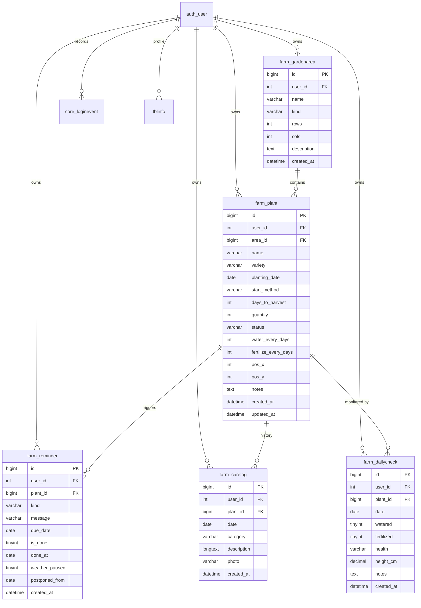

# MOSQUERA Farm Logs — Initial Table Design

Database design for the farm management app (Django, dev DB: SQLite;
production-style DDL: MariaDB 10.4 / MySQL 8, `utf8mb4`).
Generated from the current models in `apps/farm/models.py`,
`apps/core/models.py`, and `apps/info/models.py`.

## 1. Entities & relationships

Relationship rules:

- Every farm record belongs to exactly one `auth_user` (data isolation
  per account; cascade delete when the user is removed).
- A `GardenArea` holds many plants; deleting an area keeps the plants
  (`area_id` set to NULL) so map data is never lost by accident.
- A `Plant` owns reminders, care logs, and daily checks; deleting a
  plant removes them (cascade).

## 2. Table definitions

### `farm_gardenarea` — growing spaces for the garden map

| Column | Type | Null | Default | Notes |
|---|---|---|---|---|
| `id` | BIGINT | NO | AUTO_INCREMENT | Primary key |
| `user_id` | INT | NO | — | FK → `auth_user(id)`, CASCADE |
| `name` | VARCHAR(120) | NO | — | e.g. "Backyard Bed 1" |
| `kind` | VARCHAR(20) | NO | `raised_bed` | `yard`, `raised_bed`, `indoor_pot`, `greenhouse`, `other` |
| `rows` | INT UNSIGNED | NO | 4 | Grid rows, ≥ 1 |
| `cols` | INT UNSIGNED | NO | 4 | Grid columns, ≥ 1 |
| `description` | TEXT | YES | NULL | Optional notes |
| `created_at` | DATETIME(6) | NO | CURRENT_TIMESTAMP(6) | Auto-set on insert |

- **Unique:** (`user_id`, `name`) — same area name allowed for different users.
- **Index:** (`user_id`).

### `farm_plant` — a planting: what, where, when, harvest ETA

| Column | Type | Null | Default | Notes |
|---|---|---|---|---|
| `id` | BIGINT | NO | AUTO_INCREMENT | Primary key |
| `user_id` | INT | NO | — | FK → `auth_user(id)`, CASCADE |
| `area_id` | BIGINT | YES | NULL | FK → `farm_gardenarea(id)`, SET NULL |
| `name` | VARCHAR(120) | NO | — | Crop name, e.g. "Lettuce" or "Rambutan" |
| `variety` | VARCHAR(120) | YES | NULL | Optional cultivar |
| `planting_date` | DATE | NO | `CURRENT_DATE` | Sowing date for direct-seeded/seed-grown crops; transplant date for transplanted/grafted crops |
| `start_method` | VARCHAR(20) | NO | `''` | `direct` or `transplant`; blank means not recorded |
| `days_to_harvest` | INT UNSIGNED | NO | 60 | Auto-filled from the crop/method catalog (e.g. lettuce 45 from sowing, tomato 75 from transplant, rambutan 1,095 from a grafted transplant) |
| `quantity` | INT UNSIGNED | NO | 1 | Number of plants/seeds |
| `status` | VARCHAR(20) | NO | `seedling` | `seed`, `seedling`, `growing`, `flowering`, `ready`, `harvested`, `dead` |
| `water_every_days` | INT UNSIGNED | NO | 2 | Watering interval (drives reminders) |
| `fertilize_every_days` | INT UNSIGNED | NO | 14 | Fertilizing interval |
| `pos_x` | INT UNSIGNED | NO | 0 | Grid column on the map |
| `pos_y` | INT UNSIGNED | NO | 0 | Grid row on the map |
| `notes` | TEXT | YES | NULL | Free text |
| `created_at` | DATETIME(6) | NO | CURRENT_TIMESTAMP(6) | |
| `updated_at` | DATETIME(6) | NO | CURRENT_TIMESTAMP(6) ON UPDATE | |

- **Computed (not stored):** `expected_harvest_date = planting_date + days_to_harvest`;
  `days_until_harvest`; `is_ready`. `start_method` determines whether the
  planting date is the sowing date or the transplant date.
- **Index:** (`user_id`, `status`), (`area_id`).

### `farm_reminder` — automated care alerts (water / fertilize / harvest / custom)

| Column | Type | Null | Default | Notes |
|---|---|---|---|---|
| `id` | BIGINT | NO | AUTO_INCREMENT | Primary key |
| `user_id` | INT | NO | — | FK → `auth_user(id)`, CASCADE |
| `plant_id` | BIGINT | NO | — | FK → `farm_plant(id)`, CASCADE |
| `kind` | VARCHAR(20) | NO | `custom` | `water`, `fertilize`, `harvest`, `custom` |
| `message` | VARCHAR(255) | NO | — | e.g. "Water the lettuce today" |
| `due_date` | DATE | NO | `CURRENT_DATE` | Sort key for the dashboard |
| `is_done` | TINYINT(1) | NO | 0 | Completion flag |
| `done_at` | DATE | YES | NULL | When it was completed |
| `weather_paused` | TINYINT(1) | NO | 0 | 1 = auto-paused due to heavy-rain forecast |
| `postponed_from` | DATE | YES | NULL | Original due date when weather-paused |
| `created_at` | DATETIME(6) | NO | CURRENT_TIMESTAMP(6) | |

- **Index:** (`due_date`), (`plant_id`, `is_done`).
- Business rules: completing a water/fertilize reminder auto-schedules
  the next occurrence (interval from the plant row); harvest reminder
  due on `expected_harvest_date`.

### `farm_carelog` — care history with progress photos

| Column | Type | Null | Default | Notes |
|---|---|---|---|---|
| `id` | BIGINT | NO | AUTO_INCREMENT | Primary key |
| `user_id` | INT | NO | — | FK → `auth_user(id)`, CASCADE |
| `plant_id` | BIGINT | NO | — | FK → `farm_plant(id)`, CASCADE |
| `date` | DATE | NO | `CURRENT_DATE` | Day the entry describes |
| `category` | VARCHAR(20) | NO | `note` | `growth`, `pest`, `weather`, `note` |
| `description` | LONGTEXT | NO | — | What happened |
| `photo` | VARCHAR(255) | YES | NULL | Path under `media/care_photos/` |
| `created_at` | DATETIME(6) | NO | CURRENT_TIMESTAMP(6) | |

- **Index:** (`plant_id`, `date` DESC).

### `farm_dailycheck` — one monitoring entry per plant per day

| Column | Type | Null | Default | Notes |
|---|---|---|---|---|
| `id` | BIGINT | NO | AUTO_INCREMENT | Primary key |
| `user_id` | INT | NO | — | FK → `auth_user(id)`, CASCADE |
| `plant_id` | BIGINT | NO | — | FK → `farm_plant(id)`, CASCADE |
| `date` | DATE | NO | `CURRENT_DATE` | |
| `watered` | TINYINT(1) | NO | 0 | Quick-log toggle |
| `fertilized` | TINYINT(1) | NO | 0 | Quick-log toggle |
| `health` | VARCHAR(20) | NO | `good` | `poor`, `fair`, `good`, `excellent` |
| `height_cm` | DECIMAL(6,2) | YES | NULL | Growth measurement |
| `notes` | TEXT | YES | NULL | |
| `created_at` | DATETIME(6) | NO | CURRENT_TIMESTAMP(6) | |

- **Unique:** (`plant_id`, `date`) — one check per plant per day.

### `core_loginevent` — login tracking

| Column | Type | Null | Default | Notes |
|---|---|---|---|---|
| `id` | BIGINT | NO | AUTO_INCREMENT | Primary key |
| `user_id` | INT | NO | — | FK → `auth_user(id)`, CASCADE |
| `created_at` | DATETIME(6) | NO | CURRENT_TIMESTAMP(6) | Sign-in time |
| `ip_address` | VARCHAR(45) | YES | NULL | IPv4 or IPv6 |
| `user_agent` | VARCHAR(255) | YES | NULL | Browser/device string |

- **Index:** (`created_at` DESC).

### `tblinfo` — staff profile (existing table, kept as-is)

| Column | Type | Null | Default | Notes |
|---|---|---|---|---|
| `id` | BIGINT | NO | AUTO_INCREMENT | Primary key |
| `name` | VARCHAR(255) | NO | — | |
| `age` | INT UNSIGNED | NO | — | CHECK 1–150 |
| `address` | VARCHAR(255) | NO | — | |
| `email` | VARCHAR(255) | NO | — | |
| `user_id` | INT | YES | NULL | FK → `auth_user(id)`, CASCADE |
| `created_at` | DATETIME(6) | NO | CURRENT_TIMESTAMP(6) | |
| `updated_at` | DATETIME(6) | NO | CURRENT_TIMESTAMP(6) ON UPDATE | |

## 3. Design notes

1. **Normalization (3NF):** no repeating groups; intervals and defaults
   live on the plant row; harvest date is derived, never stored.
2. **Per-user isolation:** every table carries `user_id` so the dashboard
   never leaks another account's rows (`CASCADE` on user delete).
3. **Cascade policy:** area → plants use `SET NULL` (protects plant
   history); plant → reminders/logs/checks use `CASCADE` (no orphans).
4. **Weather-adaptive reminders:** `weather_paused` + `postponed_from`
   keep the original schedule while heavy rain is forecast.
5. **Crop-aware defaults:** `days_to_harvest`, `water_every_days`, and
   `fertilize_every_days` are pre-filled from the crop catalog
   (`defaults_for()` in `apps/farm/crops.py`). The catalog accepts common
   names/plurals and local Philippine aliases, and provides separate maturity
   ranges for direct-seeded and transplanted/grafted crops, so the estimate
   follows how the plant was started. Perennial fruit crops may use multi-year
   day counts; the UI formats values of 365 days or more as days plus years.
6. **Timestamps:** `created_at` on all tables (`auto_now_add`);
   `updated_at` on mutable rows (`auto_now`).

> Clean DDL: see [`SQL/farm_schema.sql`](../SQL/farm_schema.sql) (MariaDB/MySQL).
> For SQLite (dev), run `python manage.py migrate` — Django builds the
> same schema automatically.
